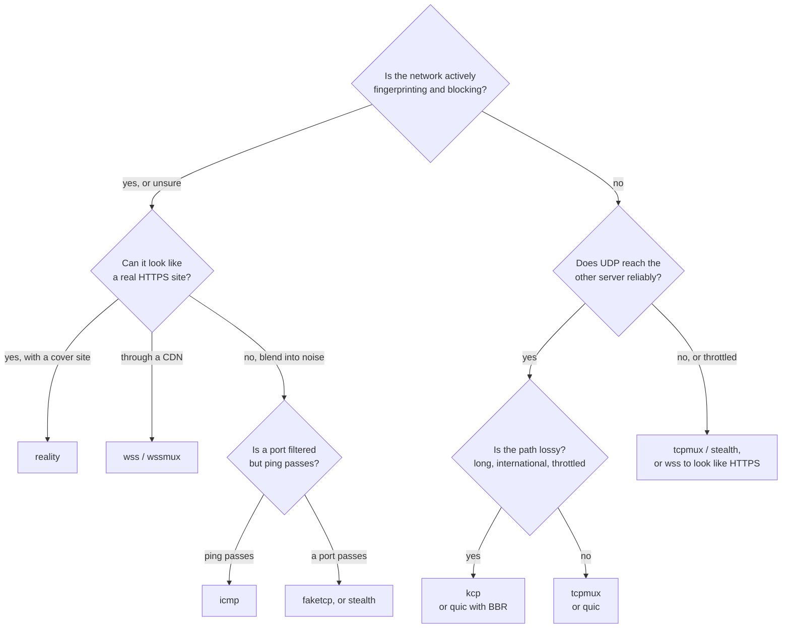

# ترنسپورت‌ها

[English](../transports.md) · **فارسی**

ترنسپورت راهی است که تانل بین دو سرور از آن می‌گذرد. فقط یک خط است، `tunnel.transport`، و باید روی هر دو سمت یکی باشد.



| ترنسپورت | روی شبکه چه می‌رود | مقاومت در برابر DPI | نیازها |
|---|---|---|---|
| `tcp` | برای هر اتصال کاربر یک اتصال TCP | رمزشده و بدون بایت ثابت، ولی یک جریان TCP بلندمدت ساده | — |
| `tcpmux` | چند اتصال TCP بلندمدت که همهٔ اتصال‌ها را می‌برند | مثل `tcp` | — |
| `ws` | WebSocket روی HTTP ساده | شبیه یک WebSocket روی HTTP | — |
| `wss` | WebSocket روی TLS (HTTPS) | شبیه یک سایت HTTPS | یک گواهی روی سمت گوش‌دهنده |
| `quic` | QUIC روی UDP: streamها و datagramها، TLS 1.3 | شبیه HTTP/3 (یا با `obfs` بایت تصادفی)؛ شکل UDP که throttle‌پذیر است | — |
| `kcp` | KCP روی UDP، هر بسته مهر‌و‌موم، با FEC اختیاری | بایت تصادفی بدون fingerprintِ handshake؛ شکل UDP که throttle‌پذیر است | — |
| `stealth` | یک جریان TCP رمزشده با padding روی طول رکورد و jitter اختیاری | بایت تصادفی، بدون fingerprintِ handshake، اندازهٔ رکوردها padding‌خورده | — |
| `wsmux` | `ws` با mux همیشه روشن | شبیه یک WebSocket روی HTTP | — |
| `wssmux` | `wss` با mux همیشه روشن | شبیه یک سایت HTTPS | یک گواهی روی سمت گوش‌دهنده |
| `udp` | تانل روی datagramهای UDP مهر‌و‌موم سوار می‌شود؛ فقط UDP را می‌برد | بایت تصادفی؛ شکل UDP که throttle‌پذیر است | — |
| `faketcp` | KCP روی یک carrier فیک‌TCP با سوکت خام | بایت تصادفی، بدون fingerprintِ handshake، شبیه یک جریان TCP | لینوکس، root (CAP_NET_RAW) |
| `icmp` | KCP داخل echo request/reply در ICMP (ping) | بایت تصادفی، بدون fingerprintِ handshake؛ جایی که پورت بسته است رد می‌شود | لینوکس، root |
| `naive` | یک پراکسی مدیریت‌شدهٔ naive روی HTTP/2 با TLS (sing-box) | شبیه HTTP/2 روی HTTPS واقعی | لینوکس، فایل helper، یک گواهی |
| `xhttp` | یک تانل مدیریت‌شدهٔ Xray از نوع VLESS روی XHTTP (HTTP/2) با TLS | شبیه یک سایت واقعی HTTPS | لینوکس، فایل helper، یک گواهی |
| `reality` | یک تانل مدیریت‌شدهٔ Xray از نوع VLESS + REALITY + Vision | handshakeِ TLS یک سایت واقعی را قرض می‌گیرد: از مرورگری که به آن سایت می‌رود قابل‌تشخیص نیست | لینوکس، فایل helper، یک سایت پوششی |

هر ترنسپورتی سرتاسر رمز می‌شود: handshake (احراز هویت دوطرفه با توکن و X25519 برای forward secrecy) و لایهٔ رکورد AEAD داخلش اجرا می‌شوند. ترنسپورت‌هایی که رمزنگاری در سطح خودِ ترنسپورت ندارند — `stealth`، `udp`، `faketcp`، `icmp`، helperهای مدیریت‌شده و حالت L3 / GRE — **رمزنگاری را اجباری می‌کنند** (`encryption = "none"` رد می‌شود)، پس هیچ چیز روی مسیر نامطمئن بی‌رمز نمی‌رود. هنگام احراز هویت ناموفق، سمت گوش‌دهنده ساکت می‌ماند: چیزی که یک probe بتواند از پورت بسته تشخیص بدهد جواب نمی‌دهد، و بعد اتصال را می‌اندازد.

## انتخاب ترنسپورت: عبور از فیلترینگ در برابر سرعت

بر اساس کاری که شبکه می‌کند انتخاب کنید، نه فقط سرعت:

- **مسیر تمیز و بدون فیلتر:** `tcpmux` (یا `quic` جایی که UDP خوب است) سریع‌ترین است.
- **CDN یا reverse proxy در میان:** `ws` / `wss` (یا دوقلوهای `wsmux` / `wssmux`شان).
- **DPIِ فعال که پروتکل‌ها را می‌شناسد:** با `reality` (قوی‌ترین: handshakeِ یک سایت پوششی واقعی را قرض می‌گیرد)، `xhttp` یا `wss` در HTTPS گم شوید؛ یا با `stealth`، `faketcp` یا `icmp` (بایت تصادفی، بدون handshakeی که بشود تطبیق داد) در نویز گم شوید.
- **شبکهٔ خصمِ UDP:** `udp`، `quic` و `kcp` خام رمزشده‌اند، ولی شکل datagram قابل‌تشخیصی دارند و اولین چیزی‌اند که شبکه‌ای که UDP را دوست ندارد throttle یا رها می‌کند (به‌ویژه UDP روی پورت ۴۴۳). آن‌جا ترنسپورت‌های **عبوردهنده** را ترجیح بدهید — `stealth` و `faketcp` روی TCP سوارند و `icmp` روی ping، پس به دام بستنِ UDP نمی‌افتند؛ `reality` شبیه HTTPS معمولی است.

## `tcp` و `tcpmux`

`tcp` برای هر اتصال کاربر یک اتصال تانل باز می‌کند. در حالت reverse، خروجی به تعداد `pool` اتصال آماده نگه می‌دارد تا کاربر تازه برای handshake منتظر نماند؛ در حالت direct، اولین بایت‌های کاربر همراه handshake می‌روند.

`tcpmux` همان `tcp` است، با mux: چند اتصال بلندمدت که هر کدام streamهای زیادی را حمل می‌کنند و هر stream کنترل جریان خودش را دارد. باز کردن یک stream هیچ رفت‌وبرگشتی لازم ندارد. روی لینوکس کاریز روی این اتصال‌ها `TCP_NOTSENT_LOWAT` را تنظیم می‌کند تا هسته صفی از داده نگه ندارد که بسته‌های UDP و streamهای تازه پشتش معطل بمانند.

روی مسیر تمیز، هر دو سریع‌ترین انتخاب‌اند. روی مسیر پراتلاف، کنترل ازدحام TCP با هر اتلاف سرعتش را نصف می‌کند: با ۱٪ اتلاف روی مسیری با ۶۰ میلی‌ثانیه تأخیر، حدود ۲ مگابیت بر ثانیه.

## `ws` و `wss`

یک WebSocket که شبیه مرورگر رفتار می‌کند، روی HTTP ساده (`ws`) یا TLS (`wss`). از CDN و reverse proxy رد می‌شوند ([راهنما](CDN.md)).

- **Early data** (`ws.early_data = true` روی سمت وصل‌شونده) پیام اول تانل را داخل درخواست upgrade می‌گذارد و یک رفت‌وبرگشت در مسیر CDN صرفه‌جویی می‌کند.
- **هر چیزی که upgrade معتبر نباشد** روی مسیر تنظیم‌شده صفحهٔ `404` یک nginx معمولی را می‌گیرد.
- **گواهی `wss`:** یا یک گواهی واقعی (Let's Encrypt) که با عوض شدن فایل‌ها دوباره بارگذاری می‌شود، یا یک گواهی خودامضا که سمت وصل‌شونده با `tls.pin_sha256` آن را pin می‌کند (`kariz pin cert.pem`).
- پشت CDN، فاصلهٔ ping را ۹۰ ثانیه یا کمتر نگه دارید؛ CDN وب‌سوکت‌های بی‌کار را حدود ۱۰۰ ثانیه بعد می‌بندد. `kariz check` در غیر این صورت هشدار می‌دهد.

### `wsmux` و `wssmux`

`wsmux` همان `ws` است با mux که به‌اجبار روشن است، و `wssmux` همان `wss` با mux اجباری — دقیقاً همان‌طور که `tcpmux` نسبت به `tcp`. همان جدول‌های `[tunnel.ws]` و `[tunnel.tls]`، همان رفتار CDN و استتار؛ تنها فرق این است که mux را نمی‌شود خاموش کرد، پس همیشه چند اتصال بلندمدت همهٔ کاربرها را می‌برند. وقتی اتصال‌های کاربرِ زیاد دارید و می‌خواهید روی اتصال کمتری بین دو سرور multiplex شوند، به‌جای `ws` / `wss` از این‌ها استفاده کنید.

## `quic`

QUIC (با quinn) روی UDP:

- هر اتصال کاربر stream خودش را در QUIC دارد: بستهٔ گم‌شده فقط stream خودش را عقب می‌اندازد.
- جریان‌های UDP به‌شکل datagramهای QUIC می‌روند. بسته‌هایی که برای یک datagram بزرگ‌اند (بالای حدود ۱٬۲۰۰ بایت) روی stream همان جریان می‌روند و باز هم می‌رسند.
- دو سمت توکن را با TLS 1.3 دوطرفه و با کلیدهایی که از آن ساخته می‌شود اثبات می‌کنند؛ فایل گواهی لازم نیست.
- کنترل ازدحام: `cubic` (پیش‌فرض)، `bbr` (زیر اتلاف تصادفی سرعتش را نگه می‌دارد، ولی صف‌ها را پر می‌کند و در quinn آزمایشی است) یا `newreno`.
- handshake شبیه HTTP/3 دیده می‌شود (ALPN برابر `h3` و SNI نام میزبان مقابل)، مگر این‌که `obfs` روشن باشد.

بعضی شبکه‌ها UDP را کند یا مسدود می‌کنند، به‌ویژه UDP روی پورت ۴۴۳. `quic` را گزینه‌ای برای مسیرهایی بدانید که UDP در آن‌ها کار می‌کند، و `tcpmux`، `wss` یا یک ترنسپورت عبوردهنده (`stealth`، `faketcp`، `icmp`) را جایگزینش نگه دارید.

### `obfs`

بسته‌های اول QUIC را هر کسی می‌تواند بخواند. پس شبکه‌ای که دنبال QUIC می‌گردد (و روی SNI آن فیلتر می‌کند) می‌تواند آن را تشخیص بدهد و بیندازد، حتی جایی که UDP‌های دیگر رد می‌شوند. اگر در `[tunnel.quic]` روی **هر دو سمت** `obfs = true` بگذارید، هر بستهٔ UDP با کلیدی که از توکن می‌آید مهر و موم می‌شود (ChaCha20-Poly1305، مثل `kcp`). آن‌وقت روی سیم هدر QUIC و شمارهٔ نسخه‌ای برای تطبیق دادن نیست و پورت به چیزی که با توکن مهر نشده باشد جواب نمی‌دهد. درون تانل چیزی عوض نمی‌شود: handshake در TLS 1.3 و streamها مثل قبل کار می‌کنند.

- برای هر بسته ۲۸ بایت خرج دارد (اندازهٔ بستهٔ QUIC همان‌قدر کم می‌شود، پس بسته‌های روی سیم هم‌اندازه می‌مانند) و کمی CPU.
- هر دو سمت باید یک جور تنظیم شده باشند. سمتی که آن را نمی‌فهمد فقط نویز می‌بیند و سمت دیگر هنگام اتصال timeout می‌خورد. در ویزارد تانل پنل، این یک کلید زیر ترنسپورت است که برای `quic` پیش‌فرض روشن است.
- این گزینه پروتکل را پنهان می‌کند، نه این‌که UDP به این آدرس می‌رود. جایی که کل UDP بسته است کمکی نمی‌کند (از `tcpmux`، `wss` یا یک ترنسپورت عبوردهنده استفاده کنید).

لینک پنل با سرورها هم می‌تواند `quic` باشد و آن همیشه مهر و موم‌شده است، بی‌هیچ تنظیمی: [پنل وب](panel.md#وصل-کردن-سرور-دیگر).

## `kcp`

KCP یک پروتکل ARQ روی UDP است که با شدت دوباره می‌فرستد و زیر اتلاف سرعتش را نگه می‌دارد، یعنی همان‌جا که TCP از پا می‌افتد.

- **هر بستهٔ UDP مهر و موم می‌شود** با کلیدی از توکن، پس پورت به هیچ چیز دیگری جواب نمی‌دهد و هدرهای KCP پنهان می‌مانند. handshake، رکوردها و mux مثل TCP داخل آن اجرا می‌شوند.
- **پیش‌تنظیم‌ها** از ملایم تا تند (`normal`، `fast`، `fast2`، `fast3`) یا `manual`.
- **FEC** (`fec_data` / `fec_parity`): بسته‌های parity از نوع Reed-Solomon بسته‌های گم‌شده را بدون ارسال دوباره بازسازی می‌کنند. پروفایل gaming آن را روی ۱۰ / ۳ می‌گذارد.
- **جریان‌های UDP کنار stream در KCP می‌روند** و هیچ‌وقت منتظر segment گم‌شده نمی‌مانند. با FEC روشن بیشتر بسته‌های گم‌شده بازسازی می‌شوند. با `datagrams = false` آن‌ها هم داخل stream می‌مانند.
- **پنجرهٔ آن می‌تواند مسیر کوچک را پر کند.** پیش‌فرض (۱۰۲۴ بسته) برای لینک‌های سریع اندازه شده؛ مقدار پهنای‌باند × RTT / 1300 بسته صف کمتری می‌سازد.

KCP در فضای کاربر و بسته‌به‌بسته اجرا می‌شود، پس روی localhost فقط به کسری از سرعت TCP می‌رسد (صدها مگابیت بر ثانیه). بین دو سرور معمولاً اهمیتی ندارد.

مثل `quic` و `udp`، `kcp` هم شکل datagram در UDP دارد که شبکهٔ خصمِ UDP می‌تواند throttle‌اش کند. آن‌جا همان استک KCP را روی یک carrier غیر‌UDP ببرید: [`faketcp`](#faketcp) (روی TCP خام) یا [`icmp`](#icmp) (روی ping).

## `stealth`

`stealth` یک جریان TCP رمزشده مثل `tcp` است، با دو افزوده که به‌جای فقط محتوا، شکل ترافیک را هم پنهان می‌کنند:

- **padding روی طول رکورد.** داخل هر رکورد AEAD (پیش از مهر‌و‌موم شدنش) padding تصادفی اضافه می‌شود، پس اندازهٔ رکوردها روی سیم لو نمی‌دهد که پیام‌های واقعی چقدر بزرگ‌اند. `padding` (پیش‌فرض روشن)، `pad_max` (بزرگ‌ترین padding در هر رکورد، پیش‌فرض ۲۵۶ بایت)، کران‌دار.
- **jitter در زمان‌بندی.** `jitter_ms` (پیش‌فرض ۰) یک تأخیر تصادفی کوچک پیش از flush شدن رکورد اضافه می‌کند، پس فاصلهٔ زمانی بین رکوردها الگو نمی‌سازد. کران‌دار؛ مگر این‌که مشخصاً نگران یک classifierِ زمانی باشید روی ۰ بگذاریدش، چون تأخیر خرج دارد.

padding و jitter **فقط روی لینک‌های stealth** اعمال می‌شوند — هر دو سمت ترنسپورت را می‌دانند — پس سیمِ هیچ ترنسپورت دیگری دست نمی‌خورد. روی سیم fingerprintی از handshake و بایت ثابتی نیست؛ هنگام احراز هویت ناموفق، سمت گوش‌دهنده ساکت می‌ماند و بعد اتصال را می‌اندازد. رمزنگاری اجباری است. mux پیش‌فرض روشن است و می‌شود خاموشش کرد (مثل `tcp` در برابر `tcpmux`). `[tunnel.stealth]` شامل `padding`، `pad_max` و `jitter_ms` است، هر کدام برای هر سمت.

## `udp`

ترنسپورت `udp` روی **datagramهای UDP ساده** سوار می‌شود: استک KCP (روی یک carrier از نوع UDP) فقط برای handshakeِ توکن و کانال کنترل به کار می‌رود، و هر datagramِ فرستاده‌شده روی مسیر datagramِ نامطمئن و مهر‌و‌موم می‌رود — بدون ارسال دوباره، FEC پیش‌فرض خاموش. این دقیقاً همان چیزی است که سرویس‌های UDP زمان‌واقعی می‌خواهند (بازی، WireGuard، صدا): بستهٔ گم‌شده فقط گم می‌شود و هیچ‌وقت آن‌هایی را که پشتش‌اند عقب نمی‌اندازد.

- هر datagram با کلیدی از توکن مهر‌و‌موم می‌شود، پس پورت به هیچ چیز دیگری جواب نمی‌دهد.
- فقط قانون‌های `protocol = "udp"` مجازند؛ قانون `tcp` یا `tcp+udp` خطای اعتبارسنجی است و `proxy_protocol` مجاز نیست (streamی نیست که هدر PROXY را ببرد).
- رمزنگاری اجباری است.

مثل `quic` و `kcp`، شکل UDPاش روی شبکهٔ خصمِ UDP throttle‌پذیر است؛ آن‌جا از `faketcp` یا `icmp` استفاده کنید.

## `faketcp`

`faketcp` (که BackPack آن را `pck` می‌نامد) استک KCP را روی یک **carrier فیک‌TCP با سوکت خام** می‌برد. بسته‌های روی سیم هدر TCP دارند و شبیه یک جریان یک‌طرفهٔ TCP از بایت‌های تصادفی‌اند، ولی پشتشان ماشین‌حالت واقعی TCP نیست — پس ترنسپورت از میان میان‌افزارهایی که فقط «TCP» را رد می‌کنند می‌گذرد، بدون آن meltdownِ ارسالِ‌دوباره‌روی‌ارسالِ‌دوباره که وقتی reliabilityِ خود تانل داخل یک اتصال TCP واقعی هسته اجرا شود پیش می‌آید.

- **فقط لینوکس، و root می‌خواهد** (یا `CAP_NET_RAW`) تا سوکت خام را باز کند. روی پلتفرم‌های دیگر، یا بدون این دسترسی، با پیامی روشن شروع نمی‌شود (`transport "faketcp" needs root (or CAP_NET_RAW)`).
- کاریز تا وقتی تانل کار می‌کند قانون‌های `iptables` را نصب می‌کند — انداختن RSTهای هسته به جریان فیکمان، و `NOTRACK` تا conntrack دخالت نکند — و هنگام توقف برمی‌داردشان (RAII). با `manage_firewall = false` تانل بی این‌ها هم کار می‌کند، ولی زیر بار نامطمئن است.
- `[tunnel.faketcp]`: `flags` (الگوی flagِ TCP این سمت، یکی از `A`، `PA`، `PA,A`، `PA,A,PA,PAU`)، `interface` و `gateway_mac` (بازنویسی egressِ خودکشف‌شده) و `manage_firewall`.
- بایت تصادفی، بدون fingerprintِ handshake. چون روی TCP سوار است، به دام بستنِ UDP نمی‌افتد. رمزنگاری اجباری است.

## `icmp`

`icmp` (که BackPack آن را `xdi` می‌نامد) استک KCP را داخل بسته‌های **echo request/reply در ICMP** می‌برد — بایت‌های تانل داخل payloadِ ping سوار می‌شوند. روی شبکه‌هایی که TCP و UDP به یک پورت را فیلتر می‌کنند ولی باز هم ping را رد می‌کنند، این جایی رد می‌شود که هیچ چیز دیگر نمی‌شود.

- **فقط لینوکس، و root می‌خواهد.** در غیر این صورت همان پیام `faketcp`.
- سمت وصل‌شونده echo request می‌فرستد؛ سمت گوش‌دهنده با echo reply که همان شناسه را دارد جواب می‌دهد. کاریز قانون‌های `iptables` را نصب می‌کند تا جواب‌های خودکار echo هسته تا وقتی تانل کار می‌کند خاموش بمانند، و هنگام توقف برمی‌داردشان (RAII). با `manage_firewall = false` کار می‌کند ولی یک uplinkِ اضافه می‌پردازد.
- ICMP پورت ندارد: آدرس میزبان را مشخص می‌کند و پورتِ تنظیم‌شده نادیده گرفته می‌شود.
- `[tunnel.icmp]`: فقط `manage_firewall`.
- بایت تصادفی، بدون fingerprintِ handshake. رمزنگاری اجباری است.

## ترنسپورت‌های helperِ مدیریت‌شده: `naive`، `xhttp`، `reality`

این سه یک **helperِ بیرونیِ مدیریت‌شده** (NaiveProxy / sing-box، یا Xray) را روی هر سمت اجرا می‌کنند، پس تانل یک استتارِ HTTPSِ آزموده و سخت‌تشخیص را به ارث می‌برد. کاریز باز هم handshake، رمزنگاری رکورد و mux خودش را **داخل** streamِ helper اجرا می‌کند، پس اعتبارِ توکن هیچ‌وقت لو نمی‌رود و رفتار half-closeِ یک پراکسی اهمیتی ندارد.

- **سمت پذیرنده** (ورودی در حالت reverse، خروجی در حالت direct) *سرورِ* helper را اجرا می‌کند. روی آدرس تانل عمومی گوش می‌دهد؛ کاریز یک شنوندهٔ loopback داخلی bind می‌کند که helper ترافیک احرازشده را به آن می‌فرستد.
- **سمت وصل‌شونده** *کلاینتِ* helper را با یک inboundِ loopbackِ محلی اجرا می‌کند که کاریز اتصال‌های تانلش را از آن می‌زند.
- **لینوکس**، و فایل helper باید نصب شده باشد: `kariz helper install <naive|sing-box|xray>` یک نسخهٔ pin‌شده را برای همان CPU دانلود می‌کند، یک sha256ِ pin‌شده را می‌سنجد و بازش می‌کند؛ `kariz helper status` نشان می‌دهد چه نصب است. `--from FILE` آرشیوی را که خودتان آپلود کرده‌اید نصب می‌کند (باز هم با sha256 سنجیده می‌شود).
- رمزنگاری اجباری است، mux به‌اجبار روشن، و helperها **فقط TCP** می‌برند (قانون forwardِ UDP خطای اعتبارسنجی است).
- `[tunnel.helper]` اعتبارها و مسیرها را دارد (نگاه کنید به [پیکربندی](configuration.md)). فقط مسیر مطلق؛ `insecure` روی سمت وصل‌شونده هیچ‌وقت مجاز نیست.

**`naive`** — sing-box inboundِ naive را اجرا می‌کند و کلاینت رسمی NaiveProxy به آن وصل می‌شود. شبیه HTTP/2 روی HTTPS واقعی است. روی هر دو سمت به `username` / `password` و روی سمت گوش‌دهنده به یک گواهی TLS نیاز دارد.

**`xhttp`** — Xray روی هر دو سمت، VLESS روی XHTTP (HTTP/2، stream-up) با TLS. شبیه یک سایت معمولی HTTPS است. به یک `uuid`، `path`، `server_name` (و `host` اختیاری) و یک گواهی TLS روی سمت گوش‌دهنده نیاز دارد.

**`reality`** — Xray روی هر دو سمت، VLESS + REALITY + Vision با fingerprintِ Chrome. REALITY handshakeِ TLS یک سایت پوششی واقعی را قرض می‌گیرد، پس **گواهیِ خودتان لازم نیست** و اتصال از مرورگری که به آن سایت می‌رود قابل‌تشخیص نیست — قوی‌ترین استتارِ این مجموعه. یک جفت کلید با `kariz helper reality-keys` بسازید: سمت پذیرنده `private_key` و `target`ِ پوششی را می‌گذارد، سمت وصل‌شونده `public_key` را؛ هر دو `uuid`، `short_id` و `server_name` (میزبانِ پوششی) را می‌گذارند. `kariz helper uuid` یک UUID تازه چاپ می‌کند.

## تانل مستقیم L3 / GRE

حالت `[l3]` شکل کاملاً متفاوتی از تانل است: به‌جای forward کردن پورت‌ها، روی هر میزبان یک **اینترفیس TUN** (`kz0`، `kz1`، …) می‌سازد و **بسته‌های کامل IP** را بینشان می‌برد — یک لینک نقطه‌به‌نقطهٔ لایهٔ ۳ که مسیرها و فایروالتان مستقیم از آن استفاده می‌کنند. این همتای رمزشده و مقاوم‌به‌DPIِ یک تانل ساده GRE است.

- **کپسوله‌سازی همیشه GRE است** (هدر RFC 2784 + کلید RFC 2890)، ولی هدر GRE و بسته‌های درونی **داخل handshake + رکورد خود کاریز** مهر‌و‌موم می‌شوند، پیش از این‌که carrier ببیندشان. **هیچ‌وقت IP proto 47 لخت روی سیم نیست** — یک ناظر منفعل فقط بایت‌های تصادفیِ carrier را می‌بیند. هر دو سمت یک مقدار `encap = "gre"` را در handshake می‌سنجند و ناسازگاری را رد می‌کنند. هر بسته یک شمارنده با پنجرهٔ replay دارد، و session به‌صورت دوره‌ای rekey می‌شود.
- **فقط carrierهای مقاوم‌به‌DPI.** `carrier` یکی از `udp`، `quic`، `faketcp` یا `icmp` است. carrierهای مطمئن (`tcp`، `tcpmux`، `ws`، `wss`، KCP مطمئن) رد می‌شوند: اجرای reliabilityِ تانل داخل یک carrierِ مطمئن دو تایمرِ ارسال دوباره را روی هم می‌گذارد (meltdownِ TCP-روی-TCP). رمزنگاری اجباری است.
- **هر دو جهت.** `mode = "listen"` منتظر اتصال ورودی می‌ماند؛ `mode = "dial"` بیرون می‌زند. هر میزبانی می‌تواند dial کند، پس لینک در هر دو معنای «direct» و «reverse» کار می‌کند.
- **لایهٔ ۲ (GRETAPِ رمزشده).** `layer = 2` به‌جای بسته‌های IP روی TUN (`layer = 3`، پیش‌فرض)، **فریم‌های کامل Ethernet** را روی یک دستگاه TAP می‌برد. آن‌وقت نوع payloadِ GRE برابر Transparent Ethernet Bridging است؛ `local_ip` / `peer_ip` اختیاری‌اند (یک TAPِ بدون‌آدرس را می‌شود فقط به یک bridge لینوکس اضافه کرد). بقیه چیزها یکسان است.
- **فقط لینوکس، root می‌خواهد** (`/dev/net/tun` + `CAP_NET_ADMIN`). دستگاه هنگام شروع ساخته و هنگام توقف برچیده می‌شود (RAII)، و آدرس‌ها و مسیرها با `ip` تنظیم می‌شوند. کاریز یک قانون MSS clamp برچسب‌دار برای SYNهای TCPِ خروجی از TUN اضافه می‌کند تا اتصال‌ها روی MTUِ کوچک‌تر سیاه‌چاله نشوند. روی پلتفرم‌های دیگر با پیامی روشن شروع نمی‌شود.
- `[l3]` همچنین `mtu` (پیش‌فرض ۱۴۰۰)، `fec_data` / `fec_parity` اختیاری، یک `gre_key` (می‌گذارد چند تانل منطقی یک carrier را به اشتراک بگذارند) و `ports` + `accept_udp` اختیاری را می‌گیرد تا چند پورت را با همان نحو `[[forward]]` روی لینک forward کنید. نگاه کنید به [پیکربندی](configuration.md).

این با GREِ شبکهٔ خصوصی که پنل بین سرورهای خودتان راه می‌اندازد فرق دارد (نگاه کنید به [شبکه‌های خصوصی](networks.md)): آن یکی یک GREِ هستهٔ بی‌رمز روی مسیر مطمئن است، ولی `[l3]` یک تانل رمزشده و استتارشده با carrier برای مسیر نامطمئن است.

## fallbackِ ترنسپورت

`[tunnel] fallback_transports` ترنسپورت‌هایی را به‌ترتیب فهرست می‌کند که وقتی ترنسپورت اصلی برقرار نشد، تانل به آن‌ها برمی‌گردد — اول اصلی امتحان می‌شود، بعد هر کدام:

```toml
[tunnel]
transport = "reality"
fallback_transports = ["wss", "tcpmux"]
fallback_dwell_secs = 60
```

- **هر دو سمت باید همان فهرست را با همان ترتیب داشته باشند.** `kariz check` و پنل می‌توانند دو سمت را مقایسه کنند؛ ناسازگاری یعنی دو سمت هیچ‌وقت روی یک کاندیدا به توافق نمی‌رسند.
- سمت پذیرنده هر کاندیدا را (اول اصلی، بعد فهرست) برای کل مدتِ dwell نگه می‌دارد تا تانلی برقرار شود؛ سمت وصل‌شونده هر کدام را به‌اندازهٔ `max(dwell / candidates, 5s)` امتحان می‌کند. وقتی کاندیدایی بالا آمد نگه داشته می‌شود، و چرخش فقط وقتی از سر می‌گیرد که کاندیدای کارکننده پنج دقیقه پایین بماند. هر لحظه یک کاندیدا کار می‌کند — پورت‌های forward‌شده را به اشتراک می‌گذارند، پس قبلی کاملاً متوقف می‌شود پیش از این‌که بعدی bind شود.
- جدول‌های لازم هر کاندیدا باید باشند و معتبر (مثلاً `wss` به `[tunnel.tls]` نیاز دارد). فهرست نمی‌تواند `auto` یا `udp` داشته باشد، نمی‌تواند اصلی را تکرار کند یا تکراری داشته باشد، و نمی‌تواند وقتی `encryption = "none"` است ترنسپورتی را که رمزنگاری می‌خواهد فهرست کند؛ ترنسپورت‌های helper به‌عنوان کاندیدا مجاز نیستند. `fallback_dwell_secs` دست‌کم ۱۰ است (پیش‌فرض ۶۰). با `transport = "auto"` مجاز نیست.
- `kariz status` و پنل نشان می‌دهند که الان کدام ترنسپورت فعال است.

## `wss` با گواهی واقعی

گوش‌دهندهٔ `wss` به‌طور پیش‌فرض یک گواهی خودامضا می‌دهد که سمت وصل‌شونده pin می‌کند. در پنل می‌توانید به‌جای آن *Let's Encrypt* را انتخاب کنید، یک دامنه (یا آدرس IPv4 عمومی) بدهید که به سرور گوش‌دهنده اشاره می‌کند و دکمه را بزنید. سرور `kariz-manager tunnel-cert` را اجرا می‌کند؛ آن هرچه پورت ۸۰ را گرفته چند ثانیه متوقف می‌کند، گواهی را می‌گیرد و تایمر تمدید را راه می‌اندازد. بعد تانل فایل‌های زیر `/etc/letsencrypt/live/` را نام می‌برد (`tunnel.tls.cert` و `key`)، هنگام تمدید دوباره می‌خواندشان، و سمت وصل‌شونده گواهی را با ریشه‌های وب می‌سنجد (بدون pin).

سمت وصل‌شونده گواهی را با **نامی که برایش صادر شده** می‌سنجد: پنل همین را `tls.sni` آن می‌گذارد، پس فرقی نمی‌کند به کدام آدرس وصل شود (آدرس خصوصی GRE، یا آدرس دیگری از همان سرور) یا چه *Host*ی در WebSocket بفرستد. گواهی‌ای که با نام دیگری سنجیده شود رد می‌شود و سمت گوش‌دهنده `received fatal alert: BadCertificate` می‌نویسد؛ در کانفیگی که دستی نوشته‌اید، `tls.sni` را دامنه یا آدرس گواهی بگذارید.

## `auto`

`transport = "auto"` برای شبکه‌هایی است که نمی‌دانید از کدام راه رد می‌شوند، یا راهی که کار می‌کرد از کار افتاده. سمتی که گوش می‌دهد همهٔ این‌ها را هم‌زمان باز می‌کند:

| ترنسپورت | پورت |
|---|---|
| `tcpmux` | TCP، پورت خود تانل |
| `kcp` | UDP، همان شمارهٔ پورت |
| `ws` | TCP، پورت بعدی (مسیر وب‌سوکت از توکن ساخته می‌شود) |

سمت وصل‌شونده با همان راهی شروع می‌کند که آخرین بار کار کرد. اگر وصل شدن چهار ثانیه گیر کند یا شکست بخورد، سراغ بعدی می‌رود و همین‌طور دور می‌زند، و آن را که رد شد به یاد می‌سپارد. این حالت همیشه mux دارد و هر ۲ ثانیه ping می‌زند (`tunnel.mux.ping_interval_secs` آن را عوض می‌کند)؛ پس لینکی که ساکت شود حدود ۴ ثانیه بعد رها می‌شود و با هر ترنسپورتی که رد شود دوباره ساخته می‌شود. هر سه پورت باید سمت گوش‌دهنده باز باشند. اگر پورت UDP یا `ws` گرفته شده باشد، آن ترنسپورت کنار گذاشته می‌شود (و در لاگ می‌آید)، ولی `tcpmux` باید بتواند bind شود. `[tunnel.kcp]` برای بخش KCP آن اعمال می‌شود؛ `[tunnel.ws]` و `[tunnel.tls]` به کار نمی‌روند.

`auto` از میان یک مجموعهٔ ثابت انتخاب می‌کند و با `fallback_transports` ترکیب نمی‌شود؛ وقتی می‌خواهید ترنسپورت‌هایی مثل `wss`، `reality` یا `faketcp` را هم داشته باشید، از فهرست fallbackِ صریح استفاده کنید.

## حالت‌ها و ترنسپورت‌ها

هر ترنسپورتی در هر دو حالت کار می‌کند. سمتی که گوش می‌دهد باید پورتش در دسترس باشد: TCP برای `tcp`، `tcpmux`، `ws`، `wss`، `stealth`، `wsmux`، `wssmux` و helperهای مدیریت‌شده؛ UDP برای `quic`، `kcp` و `udp`؛ یک سوکت خام برای `faketcp`؛ و ICMP (ping) برای `icmp`. carrierهای سوکت‌خام و ICMP، و حالت `[l3]`، فقط لینوکس‌اند و root می‌خواهند.
