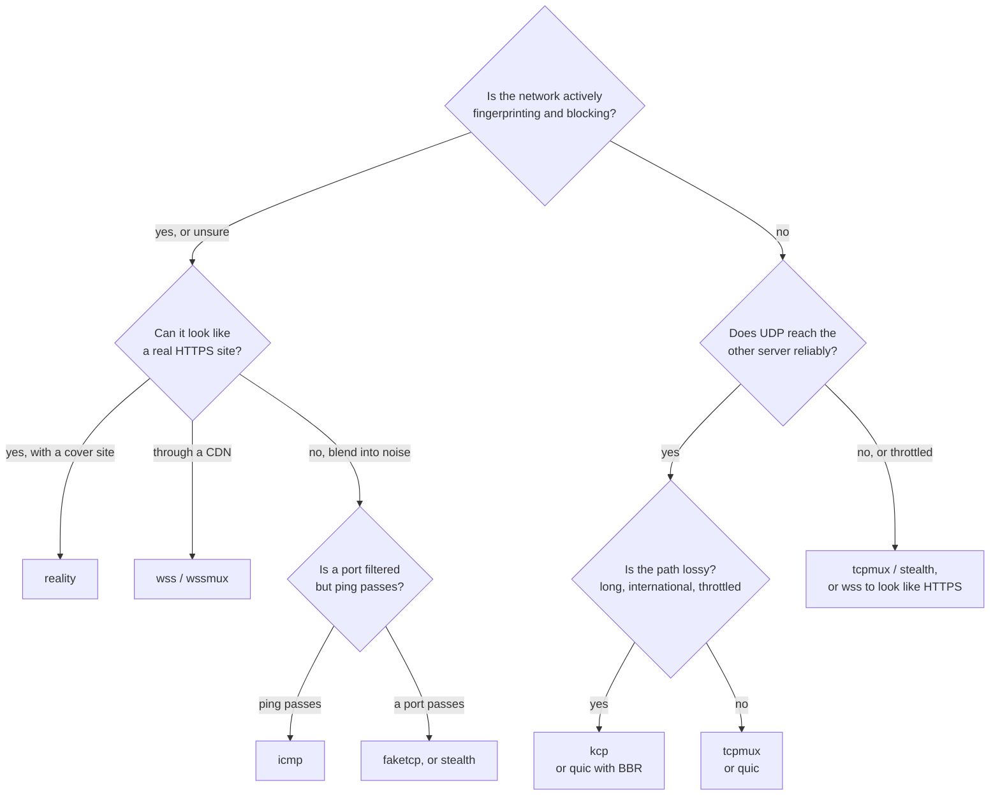

# Transports

The transport is how the tunnel travels between the two servers. It is one line,
`tunnel.transport`, and must be the same on both sides.



| Transport | What goes over the network | DPI resistance | Needs |
|---|---|---|---|
| `tcp` | one TCP connection per user connection | encrypted, no fixed bytes, but a plain long-lived TCP flow | — |
| `tcpmux` | a few long-lived TCP connections carrying all user connections | as `tcp` | — |
| `ws` | WebSocket over plain HTTP | looks like an HTTP WebSocket | — |
| `wss` | WebSocket over TLS (HTTPS) | looks like an HTTPS site | a certificate on the listening side |
| `quic` | QUIC over UDP: streams and datagrams, TLS 1.3 | reads as HTTP/3 (or random bytes with `obfs`); a UDP shape that can be throttled | — |
| `kcp` | KCP over UDP, every packet sealed, optional FEC | random bytes, no handshake fingerprint; a UDP shape that can be throttled | — |
| `stealth` | an encrypted TCP stream with record-length padding and optional jitter | random bytes, no handshake fingerprint, record sizes padded | — |
| `wsmux` | `ws` with mux always on | looks like an HTTP WebSocket | — |
| `wssmux` | `wss` with mux always on | looks like an HTTPS site | a certificate on the listening side |
| `udp` | the tunnel rides plain sealed UDP datagrams; forwards UDP only | random bytes; a UDP shape that can be throttled | — |
| `faketcp` | KCP over a raw-socket fake-TCP carrier | random bytes, no handshake fingerprint, looks like a TCP flow | Linux, root (CAP_NET_RAW) |
| `icmp` | KCP inside ICMP echo request/reply (ping) | random bytes, no handshake fingerprint; passes where a port is filtered | Linux, root |
| `naive` | a managed sing-box naive HTTP/2 proxy over TLS | looks like HTTP/2 over real HTTPS | Linux, the helper binary, a certificate |
| `xhttp` | a managed Xray VLESS-over-XHTTP (HTTP/2) tunnel with TLS | looks like a real HTTPS site | Linux, the helper binary, a certificate |
| `reality` | a managed Xray VLESS + REALITY + Vision tunnel | borrows a real site's TLS handshake: indistinguishable from a browser visiting it | Linux, the helper binary, a cover site |

Every transport is encrypted end to end: the handshake (mutual authentication with the
token, X25519 for forward secrecy) and the AEAD record layer run inside it. The transports
that have no transport-level crypto of their own — `stealth`, `udp`, `faketcp`, `icmp`, the
managed helpers, and the [L3 / GRE](#l3--gre-direct-tunnel) mode — **force encryption on**
(`encryption = "none"` is rejected), so nothing rides an untrusted path in the clear. On bad
authentication the listening side stays silent: it answers nothing a probe can tell apart
from a closed port, then drops the connection.

## Choosing a transport: evasion vs throughput

Pick by what the network does, not only by speed:

- **A clean, unfiltered path:** `tcpmux` (or `quic` where UDP is good) is fastest.
- **A CDN or reverse proxy in between:** `ws` / `wss` (or their `wsmux` / `wssmux` twins).
- **Active DPI that fingerprints protocols:** blend into HTTPS with `reality` (the strongest:
  it borrows a real cover site's handshake), `xhttp` or `wss`; or blend into noise with
  `stealth`, `faketcp` or `icmp` (random bytes, no handshake to match).
- **A UDP-hostile network:** raw `udp`, `quic` and `kcp` are encrypted, but they have a
  recognisable datagram shape and are the first things a network throttles or drops where UDP
  is unwelcome (UDP on port 443 in particular). There, prefer the **evasive** transports —
  `stealth` and `faketcp` ride TCP, and `icmp` rides ping, so they are not caught by a UDP
  block; `reality` looks like ordinary HTTPS.

## `tcp` and `tcpmux`

`tcp` opens one tunnel connection per user connection. In reverse mode the exit keeps
`pool` connections ready so a new user does not wait for the handshake; in direct mode
the user's first bytes ride along with the handshake.

`tcpmux` is `tcp` with mux: a few long-lived connections, each carrying many streams
with their own flow control. Opening a stream costs no round trip. On Linux, Kariz sets
`TCP_NOTSENT_LOWAT` on these connections so the kernel does not hold a backlog that
UDP packets and new streams would wait behind.

Both are the fastest choice on a clean path. On a lossy one, TCP's congestion control
halves its rate on every loss: at 1 % loss on a 60 ms path, about 2 Mbit/s.

## `ws` and `wss`

A WebSocket that looks like a browser's, over plain HTTP (`ws`) or TLS (`wss`). They
work through CDNs and reverse proxies ([guide](CDN.md)).

- **Early data** (`ws.early_data = true` on the dialer) puts the tunnel hello inside
  the upgrade request, saving a round trip through the CDN.
- **Anything that is not a valid upgrade** on the configured path gets the `404` page of
  a stock nginx.
- **`wss` certificates:** a real one (Let's Encrypt), reloaded when the files change, or
  a self-signed one pinned on the dialer with `tls.pin_sha256` (`kariz pin cert.pem`).
- Keep pings at 90 s or less behind a CDN, which closes idle WebSockets after about
  100 s. `kariz check` warns otherwise.

### `wsmux` and `wssmux`

`wsmux` is `ws` with mux forced on, and `wssmux` is `wss` with mux forced on — exactly as
`tcpmux` is `tcp` with mux. Same `[tunnel.ws]` and `[tunnel.tls]` tables, same CDN and decoy
behaviour; the only difference is that mux cannot be turned off, so a few long-lived
connections always carry every user. Use them instead of `ws` / `wss` when you want many
user connections multiplexed onto few connections between the servers.

## `quic`

QUIC (quinn), over UDP:

- Each user connection is its own QUIC stream: a lost packet delays only its own
  stream.
- UDP flows travel as QUIC datagrams. Packets too large for a datagram (above about
  1,200 bytes) go on the flow's stream instead, so they still arrive.
- Both sides prove the token with mutual TLS 1.3 using keys derived from it: no
  certificate files.
- Congestion control: `cubic` (default), `bbr` (keeps its speed under random loss, but
  fills queues; experimental in quinn) or `newreno`.
- The handshake reads as HTTP/3 (ALPN `h3`, SNI of the remote host), unless `obfs` is on.

Some networks throttle or block UDP, and UDP on port 443 in particular. Treat `quic` as
an option for paths where UDP works, with `tcpmux`, `wss` or an evasive transport
(`stealth`, `faketcp`, `icmp`) as the fallback.

### `obfs`

QUIC's first packets can be read by anyone, so a network that looks for QUIC (and filters
by the SNI in it) can spot and drop it even where other UDP passes. `obfs = true` in
`[tunnel.quic]`, on both sides, seals every UDP packet with a key derived from the token
(ChaCha20-Poly1305, as `kcp` does): on the wire there is no QUIC header or version to
match, and the port answers nothing that was not sealed with the token. It changes nothing
inside: the TLS 1.3 handshake and the streams run as before.

- It costs 28 bytes a packet (QUIC's packet size is lowered by as much, so the packets on
  the wire stay the same size) and some CPU.
- Both sides must agree. A side that does not speak it sees noise, and the other side
  times out connecting. In the panel's tunnel wizard it is a switch under the transport,
  on by default for `quic`.
- It hides the protocol, not the fact that UDP flows to this address; where all UDP is
  blocked it does not help (use `tcpmux`, `wss` or an evasive transport).

The link between the panel and a server can be `quic` too, and that one is always sealed, with no
setting: [The web panel](panel.md#connect-another-server).

## `kcp`

KCP is an ARQ protocol over UDP that resends aggressively and keeps its rate under
loss, where TCP collapses.

- **Every UDP packet is sealed** with a key from the token, so the port answers nothing
  else and KCP's headers are hidden. The handshake, records and mux run inside it as
  over TCP.
- **Presets** from gentle to aggressive (`normal`, `fast`, `fast2`, `fast3`) or
  `manual`.
- **FEC** (`fec_data` / `fec_parity`): Reed-Solomon parity rebuilds lost packets without
  a resend. The gaming profile turns on 10 / 3.
- **UDP flows travel beside KCP's stream**, never waiting for a lost segment. With FEC
  on, lost ones are mostly rebuilt. `datagrams = false` keeps them in the stream
  instead.
- **Its window can overfill a small path.** The default (1024 packets) is sized for
  fast links; about bandwidth x RTT / 1300 packets queues less.

KCP runs in user space, a packet at a time, so on localhost it reaches a fraction of
TCP's speed (hundreds of Mbit/s). Between two servers this rarely matters.

Like `quic` and `udp`, `kcp` has a UDP datagram shape that a UDP-hostile network can
throttle. Where that happens, carry the KCP stack over a non-UDP carrier instead:
[`faketcp`](#faketcp) (raw TCP) or [`icmp`](#icmp) (ping).

## `stealth`

`stealth` is an encrypted TCP stream like `tcp`, with two additions that hide the shape of
the traffic rather than only its contents:

- **Record-length padding.** Random padding is added inside each AEAD record (before it is
  sealed), so the record sizes on the wire do not leak how big the real messages are.
  `padding` (default on), `pad_max` (the largest padding per record, default 256 bytes),
  bounded.
- **Timing jitter.** `jitter_ms` (default 0) adds a small random delay before a record is
  flushed, so the timing between records does not form a pattern. Bounded; leave it at 0
  unless you are specifically worried about a timing classifier, as it costs latency.

Padding and jitter apply **only to stealth links** — both ends know the transport — so no
other transport's wire is touched. On the wire there is no handshake fingerprint and no
fixed bytes; on bad authentication the listening side stays silent and then drops the
connection. Encryption is mandatory. Mux is on by default and can be turned off (like `tcp`
vs `tcpmux`). `[tunnel.stealth]` holds `padding`, `pad_max` and `jitter_ms`, each per side.

## `udp`

The `udp` transport rides **plain UDP datagrams**: the KCP stack (over a UDP carrier) is
used only for the token handshake and the control channel, and every forwarded datagram
goes on the unreliable, sealed datagram path — no retransmit, FEC off by default. That is
exactly what real-time UDP services want (games, WireGuard, voice): a lost packet is simply
gone, never delaying the ones behind it.

- Every datagram is sealed with a key from the token, so the port answers nothing else.
- Only `protocol = "udp"` forward rules are allowed; a `tcp` or `tcp+udp` rule is a
  validation error, and `proxy_protocol` is not allowed (there is no stream to carry a
  PROXY header).
- Encryption is mandatory.

Like `quic` and `kcp`, its UDP shape can be throttled on a UDP-hostile network; use
`faketcp` or `icmp` there.

## `faketcp`

`faketcp` (BackPack calls it `pck`) carries the KCP stack over a **raw-socket fake-TCP
carrier**. The packets on the wire carry a TCP header and look like a one-way TCP flow of
random-looking bytes, but there is no real TCP state machine behind them — so the transport
slips through middleboxes that only forward "TCP", without the retransmit-over-retransmit
meltdown of running the tunnel's own reliability inside a real kernel TCP connection.

- **Linux only, and needs root** (or `CAP_NET_RAW`) to open the raw socket. On other
  platforms, or without the privilege, it fails to start with a clear message
  (`transport "faketcp" needs root (or CAP_NET_RAW)`).
- Kariz installs `iptables` rules while the tunnel runs — drop the kernel's RSTs to our
  fake flow, and `NOTRACK` so conntrack does not interfere — and removes them on stop
  (RAII). `manage_firewall = false` keeps the tunnel running without them, but it is
  unreliable under load.
- `[tunnel.faketcp]`: `flags` (this end's TCP flag pattern, one of `A`, `PA`, `PA,A`,
  `PA,A,PA,PAU`), `interface` and `gateway_mac` (override the auto-detected egress), and
  `manage_firewall`.
- Random bytes, no handshake fingerprint. Because it rides TCP, it is not caught by a UDP
  block. Encryption is mandatory.

## `icmp`

`icmp` (BackPack calls it `xdi`) carries the KCP stack inside **ICMP echo request/reply**
packets — the tunnel's bytes ride in ping payloads. On networks that filter TCP and UDP to a
port but still pass ping, this gets through where nothing else does.

- **Linux only, and needs root.** Same message as `faketcp` otherwise.
- The dialer sends echo requests; the listening side answers with echo replies carrying the
  same identifier. Kariz installs `iptables` rules to suppress the kernel's own automatic
  echo replies while the tunnel runs and removes them on stop (RAII). `manage_firewall =
  false` keeps it running but pays an extra uplink.
- ICMP has no ports: the address identifies the host, and the configured port is ignored.
- `[tunnel.icmp]`: just `manage_firewall`.
- Random bytes, no handshake fingerprint. Encryption is mandatory.

## Managed helper transports: `naive`, `xhttp`, `reality`

These three run a **managed external helper** (NaiveProxy / sing-box, or Xray) on each side,
so the tunnel inherits a proven, hard-to-fingerprint HTTPS disguise. Kariz still runs its own
handshake, record encryption and mux **inside** the helper's stream, so the token credential
is never exposed and the half-close quirks of a proxy do not matter.

- The **acceptor** (the entry in reverse mode, the exit in direct mode) runs the helper
  *server*. It listens publicly on the tunnel address; Kariz binds an internal loopback
  listener the helper forwards authenticated traffic to.
- The **dialer** runs the helper *client* with a local loopback inbound that Kariz dials
  its tunnel connections through.
- **Linux**, and the helper binary must be installed: `kariz helper install <naive|sing-box|xray>`
  downloads a pinned version for the CPU, verifies a pinned sha256, and unpacks it; `kariz
  helper status` lists what is installed. `--from FILE` installs an archive you uploaded
  (still sha256-checked).
- Encryption is mandatory, mux is forced on, and the helpers carry **TCP only** (a UDP
  forward rule is a validation error).
- `[tunnel.helper]` holds the credentials and paths (see
  [Configuration](configuration.md#tunnelhelper-naive-xhttp-reality)). Absolute paths only;
  `insecure` is never allowed on the dialer.

**`naive`** — sing-box runs the naive inbound, the official NaiveProxy client dials it. It
looks like HTTP/2 over real HTTPS. Needs `username` / `password` on both sides and a TLS
certificate on the listening side.

**`xhttp`** — Xray on both ends, VLESS over XHTTP (HTTP/2, stream-up) with TLS. It looks like
an ordinary HTTPS site. Needs a `uuid`, `path`, `server_name` (and optional `host`) and a TLS
certificate on the listening side.

**`reality`** — Xray on both ends, VLESS + REALITY + Vision with a Chrome fingerprint. REALITY
borrows the TLS handshake of a real cover site, so there is **no certificate of your own** and
the connection is indistinguishable from a browser visiting that site — the strongest disguise
of the set. Make a key pair with `kariz helper reality-keys`: the acceptor sets `private_key`
and the cover `target`, the dialer sets `public_key`; both set `uuid`, `short_id` and
`server_name` (the cover host). `kariz helper uuid` prints a fresh UUID.

## L3 / GRE direct tunnel

The `[l3]` mode is a whole different shape of tunnel: instead of forwarding ports, it creates
a **TUN interface** (`kz0`, `kz1`, …) on each host and carries **whole IP packets** between
them — a point-to-point layer-3 link your routes and firewall can use directly. It is the
encrypted, DPI-resistant counterpart of a plain GRE tunnel.

- **Encapsulation is always GRE** (RFC 2784 header + RFC 2890 key), but the GRE header and
  the inner packets are sealed **inside Kariz's own handshake + record session** before the
  carrier sees them. With every carrier but `proto47` there is **never bare IP proto 47 on the
  wire** — a passive observer sees only the carrier's random-looking bytes. Both ends compare
  an `encap = "gre"` value in the handshake and refuse a mismatch. Each packet carries a
  counter with a replay window, and the session rekeys periodically.
- **Unreliable carriers only.** `carrier` is one of `udp`, `quic`, `faketcp`, `icmp` or
  `proto47`. Reliable carriers (`tcp`, `tcpmux`, `ws`, `wss`, reliable KCP) are rejected:
  running the tunnel's reliability inside a reliable carrier stacks two retransmit timers (the
  TCP-over-TCP meltdown). Encryption is mandatory.
- **`proto47` — a raw protocol-47 carrier.** This carrier rides the sealed KCP packets as the
  payload of a keyed GRE packet on a **raw IP protocol 47** socket. It is still Kariz's own
  encrypted, authenticated session — **not** bare cleartext GRE, and **not interoperable with
  standard/kernel GRE**. Protocol 47 has no port, so it **does not traverse NAT** and, being a
  single identifiable IP protocol, **does not evade DPI**. Linux only, needs root
  (`CAP_NET_RAW`). Use it only on a trusted/uncensored point-to-point link where the low
  overhead or a proto-47-only path matters; for a censored path prefer `udp`, `quic`,
  `faketcp` or `icmp`. With `manage_firewall` (default on) a best-effort `-p gre -j ACCEPT`
  iptables rule is installed and removed (RAII) so the packets survive a default-DROP INPUT
  policy.
- **Both directions.** `mode = "listen"` waits for the inbound connection; `mode = "dial"`
  reaches out. Either host may dial, so the link is usable in both the "direct" and the
  "reverse" sense.
- **Layer 2 (encrypted GRETAP).** `layer = 2` carries whole **Ethernet frames** over a TAP
  device instead of IP packets over a TUN (`layer = 3`, the default). The GRE payload type is
  then Transparent Ethernet Bridging; `local_ip` / `peer_ip` are optional (an address-less TAP
  can just be added to a Linux bridge). Everything else is the same.
- **Linux only, needs root** (`/dev/net/tun` + `CAP_NET_ADMIN`). The device is created on start
  and torn down on stop (RAII), with addresses and routes set via `ip`. Kariz adds a tagged MSS
  clamp rule for TCP SYNs leaving the TUN so connections do not black-hole on the smaller MTU.
  On other platforms it refuses at startup with a clear message.
- `[l3]` also takes `mtu` (default 1400), optional `fec_data` / `fec_parity`, a `gre_key`
  (lets several logical tunnels share a carrier), and optional `ports` + `accept_udp` to
  forward a few ports over the link with the ordinary `[[forward]]` syntax. See
  [Configuration](configuration.md#l3-the-layer-3--gre-direct-tunnel).

This is distinct from the private-network GRE the panel sets up between your own servers (see
[Private networks](networks.md)): that one is a plaintext kernel GRE on a trusted path, while
`[l3]` is an encrypted, carrier-disguised tunnel for an untrusted one.

## Transport fallback

`[tunnel] fallback_transports` lists transports the tunnel falls back to, in order, when the
primary one cannot be established — the primary is tried first, then each candidate:

```toml
[tunnel]
transport = "reality"
fallback_transports = ["wss", "tcpmux"]
fallback_dwell_secs = 60
```

- **Both sides must use the same list in the same order.** `kariz check` and the panel can
  compare the two sides; a mismatch means the ends never settle on the same candidate.
- The acceptor holds each candidate (primary first, then the list) for the whole dwell until
  a tunnel is established; the dialer tries each for `max(dwell / candidates, 5s)`. Once a
  candidate is up it is kept, and rotation resumes only if the working candidate stays down
  for five minutes. One candidate runs at a time — they share the forwarded ports, so the old
  one is fully stopped before the next binds.
- Every candidate's required tables must be present and valid (for example `wss` needs
  `[tunnel.tls]`). The list cannot contain `auto` or `udp`, cannot repeat the primary or a
  duplicate, and cannot list a transport that requires encryption when `encryption = "none"`;
  helper transports are not allowed as candidates. `fallback_dwell_secs` is at least 10
  (default 60). Not allowed with `transport = "auto"`.
- `kariz status` and the panel show which transport is currently active.

## `wss` with a real certificate

By default a listening `wss` side serves a self-signed certificate that the dialing side pins.
In the panel you can instead choose *Let's Encrypt*, give a domain (or a public IPv4 address) that
points at the listening server, and press the button: the server runs
`kariz-manager tunnel-cert`, which stops whatever holds port 80 for a few seconds, gets the
certificate, and sets up the renewal timer. The tunnel then names the files under
`/etc/letsencrypt/live/` (`tunnel.tls.cert` / `key`), reloads them when they are renewed, and the
dialing side checks the certificate against the web's roots (no pin).

The dialing side checks it against **the name it was issued for**: the panel sets that as its
`tls.sni`, so it does not matter which address the side dials (a private GRE address, another
address of the server) or which WebSocket *Host* it sends. A certificate checked against another
name is refused, and the listening side logs `received fatal alert: BadCertificate`; in a config
written by hand, set `tls.sni` to the certificate's domain or address.

## `auto`

`transport = "auto"` is for networks where you do not know which way gets through, or where a
way that worked stops working. The listening side opens all of these at once:

| Transport | Port |
|---|---|
| `tcpmux` | TCP, the tunnel's port |
| `kcp` | UDP, the same port number |
| `ws` | TCP, the next port (the WebSocket path is made from the token) |

The dialing side starts with the one that worked last. If connecting stalls for four seconds,
or fails, it tries the next, round and round, and remembers the one that got through. It
always multiplexes and pings every 2 seconds (`tunnel.mux.ping_interval_secs` changes it), so
a link that goes quiet is dropped after about 4 seconds and made again over whichever
transport gets through. It needs the three ports open on the listening side; if the UDP or
`ws` port cannot be bound, that transport is left out (and logged), and `tcpmux` must bind.
`[tunnel.kcp]` applies to its KCP part; `[tunnel.ws]` and `[tunnel.tls]` are not used.

`auto` picks among a fixed set and cannot be combined with `fallback_transports`; use the
explicit fallback list when you want to include transports such as `wss`, `reality` or
`faketcp`.

## Modes and transports

Every transport works in both modes. The listening side needs its port reachable:
TCP for `tcp`, `tcpmux`, `ws`, `wss`, `stealth`, `wsmux`, `wssmux` and the managed helpers;
UDP for `quic`, `kcp` and `udp`; a raw socket for `faketcp`; and ICMP (ping) for `icmp`. The
raw-socket and ICMP carriers, and the `[l3]` mode, are Linux-only and need root.
